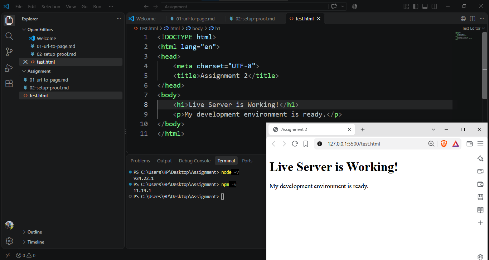

# Assignment 2 – Setup Proof

## Objective
To set up and verify the web development environment.

## Tools Used
1. Visual Studio Code
2. Node.js
3. npm
4. Live Server Extension

## Node.js and npm Verification
Node.js Version: v24.22.1

npm Version: 11.19.1

Both Node.js and npm are installed and working correctly.

## Setup Steps
1. Opened Visual Studio Code.
2. Checked the Node.js version using `node -v`.
3. Checked the npm version using `npm -v`.
4. Installed the Live Server extension.
5. Created an HTML test file.
6. Opened the HTML file in the browser using Live Server.

## Result
The development environment was successfully verified.
Node.js, npm, and Live Server are working correctly.
The HTML page opened successfully in the browser.

## Screenshot

[Click here to open the screenshot](./screenshots/setup-proof.png)